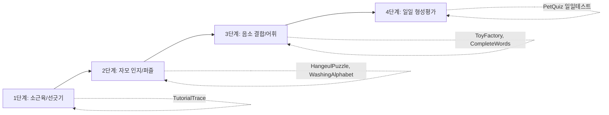
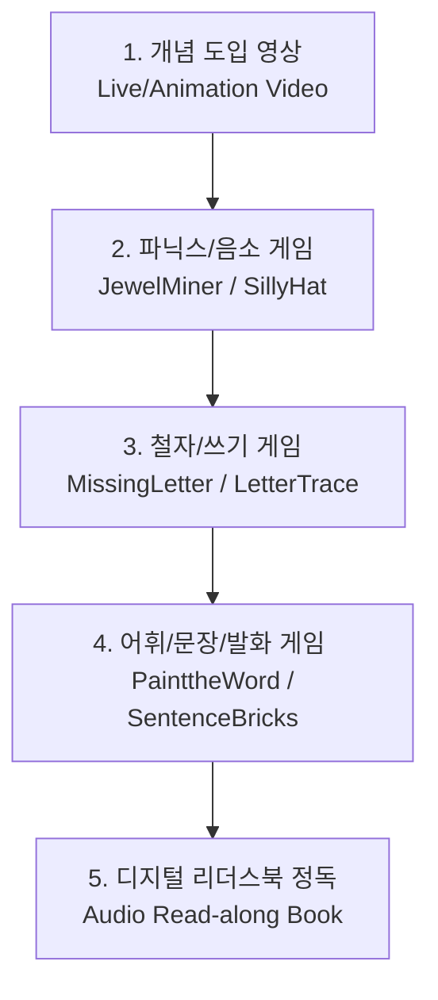

# 유아 학습 웹 서비스 명세서: 미니게임 명세·인터랙션 풀이방식·일일 수업 설계 아키텍처

---

## 목차
1. [한글 : 미니게임 명세 및 수업 설계](#1-한글-hangeul-미니게임-명세-및-수업-설계)
2. [수학 : 미니게임 명세 및 수업 설계](#2-수학-math-미니게임-명세-및-수업-설계)
3. [영어 : 미니게임 명세 및 수업 설계](#3-영어-english-미니게임-명세-및-수업-설계)
5. [공통 상호작용 및 풀이방식 (Interaction Paradigms)](#4-공통-상호작용-및-풀이방식-interaction-paradigms)
6. [일일 수업 설계 아키텍처 (Lesson Plan Architecture)](#5-일일-수업-설계-아키텍처-lesson-plan-architecture)

---

## 1. 한글 : 미니게임 명세 및 수업 설계

### 1.1 교육과정 철학 및 단계별 구조
- 한글과목은 자모를 단순 글자가 아닌 '소리의 블록'으로 인식시키는 **훈민정음 창제 원리(자모 결합형 파닉스)**를 디지털화
- 총 14개 챕터, 106개 유닛으로 구성
- **챕터 1~3 (자모 인지 단계)**: 자음 14자, 기본 모음 10자의 모양과 소리 탐색. 손가락 선긋기 및 직관적 퍼즐.
- **챕터 4~7 (단자모 결합 단계)**: 자음+모음(가, 나, 다...) 결합 구조 체득. 자음과 모음이 만나 하나의 음절을 이루는 원리 시각화.
- **챕터 8~10 (받침 학습 단계)**: 대표 받침(ㅇ, ㅁ, ㄴ, ㄹ, ㄱ, ㅂ, ㅅ)의 음가와 글자 조립. 어휘량 폭발적 확장.
- **챕터 11~14 (복잡한 모음/쌍자음 및 문장)**: ㅐ, ㅔ, ㅘ, ㅝ 등 이중모음과 ㄲ, ㄸ, ㅃ 등 쌍자음, 문장 부호 및 짧은 글 독해/작문.

### 1.2 한글 미니게임 전체 명세 (73종)
| 순번 | 게임 식별자(uKey) | 한국어 공식 명칭 | 영역 태그 | 게임 설명 및 학습 목표 |
|---|---|---|---|---|
| 1 | `EasyPuzzle` | **그림 조각 맞추기** | `all` | 퍼즐 조각을 맞추면 어떤 그림이 나올까요? 퍼즐을 맞춰 움직이는 그림을 완성해 봐요. |
| 2 | `TutorialTrace` | **따라 그리기** | `all,writing` | 선을 그어 여러 가지 그림을 따라 그려 보세요. |
| 3 | `FlashCard` | **낱말 카드** | `all,vocabulary,word` | 동물 친구와 카드 놀이를 해요. 카드에 적힌 낱말을 잘 기억해서 답을 맞혀 보세요. |
| 4 | `ToyFactory` | **장난감 공장** | `all,word` | 장난감 공장의 몬스터들을 도와요! 몬스터들의 말을 듣고 상자에 알맞은 물건을 담아 주세요. |
| 5 | `LiteracyMatching` | **카드 맞추기** | `all,word` | 같은 카드끼리 짝을 맞춰 봅시다. 같은 글자, 같은 그림, 또는 그림과 단어의 짝을 맞추면 완성! |
| 6 | `TalkingRaccoon` | **말하는 코알라** | `all,talking` | 코알라가 시키는 대로 소리 내어 말해 보세요. |
| 7 | `MemoryMatch` | **카드를 기억해** | `all,word` | 기억력을 테스트해 봐요! 짝꿍 카드가 어디 있는지 기억할 수 있나요? |
| 8 | `LineMatching` | **선 긋기** | `all,alphabet,vocabulary` | 서로 연결되는 것을 찾아서 선으로 이어 봐요. |
| 9 | `FindThePair` | **All_App_GameTitle_FindThePair** | `all,alphabet` | All_App_GameDesc_FindThePair |
| 10 | `SillyHat` | **누가 누가 다를까** | `all,listening` | 한 친구만 다른 소리를 내고 있어요. 누구인지 찾아서 모자를 씌워 주세요. |
| 11 | `HangeulPuzzle` | **한글 퍼즐** | `all,alphabet` | 한글의 자음과 모음은 어떻게 생겼을까요? 나무 블록을 하나씩 끼우면서 한글의 자음과 모음을 배워 봅시다. |
| 12 | `JewelMiner` | **보석 광산** | `all,alphabet` | 두더지와 함께 보석 광산에 왔어요. 알맞은 글자를 찾으면 빛나는 보석을 모을 수 있어요! |
| 13 | `LetterTracingCard` | **자음 모음 따라쓰기** | `all,alphabet` | 한글의 자음과 모음을 따라서 써 봐요. 카드의 뒷면에는 무엇이 숨어 있을까요? |
| 14 | `WashingAlphabet` | **목욕 시간** | `all,alphabet` | 더러워진 글자를 깨끗이 씻겨 주며 각 글자가 내는 소리를 들어 보세요. |
| 15 | `AlphabetCardPuzzle` | **글자 조각 맞추기** | `all,alphabet` | 퍼즐 조각을 맞추면 어떤 글자가 될까요? 조각을 맞춰 글자를 완성하고 그 글자가 들어간 낱말을 확인해 보아요. |
| 16 | `ISpy` | **나를 찾아줘** | `all,word` | 나는 누구일까요? 마법의 힘으로 그림을 스티커로 바꾸어 내가 누군지 찾아 주세요. |
| 17 | `LetterPicker` | **돌려라 글자판** | `all` | 글자판을 돌려 가며 알맞은 자음과 모음을 골라 주어진 글자를 완성해 보세요. |
| 18 | `PetDictation` | **여우의 받아쓰기** | `all,talking` | 여우가 받아쓰기를 해요. 큰 소리로 여우에게 낱말을 읽어 주세요. |
| 19 | `LetterTunnel` | **으랏차 글자 광산** | `all` | 빈칸에 들어갈 자음, 모음을 골라 글자를 완성하면서 글자 광산을 탐험해 보세요. |
| 20 | `WordGrocery` | **동물 마트** | `all,word` | 동물 친구가 마트에서 물건 사는 것을 도와 주세요. 각종 과일과 음료수, 간식까지! 동물 친구가 원하는 것을 잘 보고 종류별로 물건을 골라 봅시다. |
| 21 | `LetterTrace` | **따라쓰기** | `all,alphabet` | 모래사장에 글씨를 따라 쓰며 글자를 쓰는 바른 순서를 익혀 봅시다. |
| 22 | `CompleteLetters` | **모여라 자음 모음** | `all,writing` | 자음과 모음을 제자리에 넣어 주어진 낱말을 완성해 보세요. |
| 23 | `SortingRockets` | **낱말 로켓** | `all,word` | 알맞은 낱말을 골라 넣어 로켓을 발사시켜 주세요. |
| 24 | `WordCardPuzzle` | **낱말 조각 맞추기** | `all,word` | 글자를 제자리에 놓으면 낱말이 완성되고, 그림도 조금씩 선명해지지요. |
| 25 | `RhythmHangeul` | **리듬 한글** | `all,alphabet` | 자음과 모음을 모아 글자를 완성하면 신나는 리듬이 흘러나와요! |
| 26 | `FantasticChocolate` | **신기한 초콜릿** | `all,listening` | 들려주는 소리에 맞게 젤리와 초콜릿을 자르거나 붙여 쟁반에 올려 보아요. |
| 27 | `GoupStage` | **무대 위로 올라가** | `all,listening` | 주어진 소리를 만드는 데 필요한 친구들을 무대 위로 올려 주세요. |
| 28 | `CompleteWords` | **낱말 완성하기** | `all,alphabet` | 잘그락거리는 글자 조각들을 맞춰 봅시다. 그림을 보고, 또 소리를 듣고 단어를 완성해 봐요. |
| 29 | `PhonicsStation` | **말소리 정류장** | `all,reading` | 안내에 따라 손님과 짐을 알맞은 차에 넣어 주세요. |
| 30 | `WordTracing` | **칠판 따라쓰기** | `all,sentence,vocabulary` | 칠판 위에 글씨를 따라 써 봐요. 글씨를 다 쓰고 나면 멋진 그림이 나온답니다. |
| 31 | `Labeling` | **이름표 붙이기** | `all,vocabulary` | 그림의 빈칸에 알맞은 이름표를 붙여 주세요. |
| 32 | `WordSearch` | **숨은 낱말 찾기** | `all,word` | 글자들 속에 낱말이 숨어 있어요. 맞는 글자를 이어 낱말을 찾아 주세요. |
| 33 | `ListenNMatch` | **별빛 소리** | `all,listening` | 소리를 잘 듣고 밤하늘의 글자들 중 알맞은 것을 찾아 보아요. |
| 34 | `PhonicsPresentation` | **말소리 발표** | `all,reading` | 말소리에 맞는 글자를 모두 찾아 주세요. |
| 35 | `DogPhonics` | **강아지 먹이 주기** | `all,reading` | 강아지가 내는 소리를 잘 듣고 알맞은 글자가 적힌 간식을 주세요. |
| 36 | `SimpleWriting` | **글자를 써보자** | `all,writing` | 주어진 글자를 바르게 쓰면 나만의 특별한 옷이 만들어져요. |
| 37 | `StarFall` | **구름 타자치기** | `all,vocabulary,writing` | 밤하늘에서 살랑살랑 양이 내려와요. 양에 쓰여 있는 글자를 보고 한글 타자 연습을 해 봅시다. |
| 38 | `TypeTimeKorean` | **타자 연습** | `all,writing` | 카드에 적힌 글자와 낱말을 자판을 눌러 똑같이 만들어 보면서 타자 연습을 해 보아요. |
| 39 | `WhatIsThis` | **무엇일까요** | `all,vocabulary` | 그림에 어울리는 설명을 고르거나, 설명에 어울리는 그림을 골라 보아요. |
| 40 | `CrossWord` | **십자말풀이** | `all,word` | 알맞은 낱말을 알아내어 가로세로 빈칸을 모두 채워 보아요. |
| 41 | `Matrix` | **한글표 완성하기** | `all` | 한글표의 빈칸을 채워 주세요. 어떤 조각이 어느 자리에 들어가야 표가 완성될까요? |
| 42 | `MagicPot` | **마법의 솥** | `all,word` | 한글 입력기를 사용하여 신비로운 마법의 솥에 재료를 하나씩 넣어 봅시다. 마법의 레시피를 모두 완성하면 무엇이 만들어질까요? |
| 43 | `SpellBalls` | **열매를 받아라** | `all` | 나무에서 떨어지는 글자 열매를 잘 받아서 알맞은 자리에 놓아 주세요. |
| 44 | `CompleteTheSentence` | **조각 조각 붙여요** | `all` | 문장이 군데군데 비어 있어요. 글씨가 적힌 종이 조각을 알맞은 곳에 붙여 주세요. |
| 45 | `SentenceMaker` | **문장 만들기** | `all,writing` | 문장이 조각조각 나눠졌어요. 그림과 소리에 맞게 조각을 제자리에 넣어 봅시다. |
| 46 | `WordKicker` | **단어 축구** | `all,word` | 귀여운 새들이 말하는 것을 잘 듣고 빈칸에 들어갈 단어를 골라 봅시다. 올바른 단어를 고르면 시원하게 공을 찰 수 있어요. |
| 47 | `ExplaintoMe` | **설명해 주세요** | `all,reading` | 고양이와의 퀴즈 시간이에요. 무엇을 생각하고 있는지 서로 알아 맞혀 보세요. |
| 48 | `MissingWords` | **글자가 사라졌다** | `all,word` | 공책에서 갑자기 글자들이 사라졌어요! 사라진 글자를 채워 넣어 글을 완성해 보아요. |
| 49 | `WordDictation` | **손글씨 낱말 카드** | `all,writing` | 소리를 듣고 바르게 글자를 쓰면 멋진 손글씨 낱말 카드가 완성되어요. |
| 50 | `LightUp` | **전구 켜기** | `all,reading` | 문장을 소리 내어 읽어 봐요. 전구에 반짝반짝 불이 켜진답니다. |
| 51 | `LetterTyper` | **듣고 글자 고르기** | `all` | 문장을 잘 듣고 알맞은 글자를 눌러 빈칸을 채워 보아요. |
| 52 | `GraphemeTyper` | **듣고 글자 만들기** | `all` | 문장을 잘 듣고 빈칸에 들어갈 글자를 만들어 보아요. |
| 53 | `ReadingActivity` | **읽고 답해요** | `all,reading` | 글을 또박또박 소리 내어 읽은 후 질문에 답해 보아요. |
| 54 | `JellyAffix` | **젤리 문장 만들기** | `all` | 젤리로 된 문장에 군데군데 빈 곳이 있어요. 알맞은 젤리를 넣어 문장을 완성해 보세요. |
| 55 | `StickySentences` | **쪽지를 붙이면** | `all` | 종이의 빈 곳에 알맞은 쪽지를 붙여 문장과 글을 완성해 보아요. |
| 56 | `HandwritingTyper` | **듣고 손으로 쓰기** | `all` | 문장을 잘 듣고 빈칸에 들어갈 글자를 써 보아요. |
| 57 | `KeyboardTyper` | **듣고 타자치기** | `all` | 문장을 잘 듣고 타자로 빈칸을 채워 보아요. |
| 58 | `HangeulTyper` | **한글입력기** | `all` | 한글입력기 입니다. |
| 59 | `PetQuiz` | **퀴즈의 시간** | `all` | 퀴즈를 풀어 우표를 모아 보세요! |
| 60 | `WordChallenge` | **낱말 퀴즈 은하** | `all` | All_App_GameDesc_WordChallenge |
| 61 | `TrainTime` | **시계 기차** | `all,numbers,reading` | 기차가 몇 시에 떠날까요? 시계를 보고 몇 시인지 맞추면 기차가 출발합니다. |
| 62 | `Painting` | **자유 그리기** | `all` | 그림판에 자유롭게 그리고 저장해 보세요. |
| 63 | `Coloring` | **색칠하기** | `all` | 원하는 그림을 선택해 예쁘게 색칠하고 저장해 보세요. |
| 64 | `WritingPractice` | **낱말 쓰기 연습** | `all,writing` | 원하는 낱말을 선택해 쓰기 연습을 하고 저장해 보세요. |
| 65 | `WordSearchChallenge` | **낱말 찾기 은하 1** | `all,word` | All_App_GameDesc_WordSearchChallenge |
| 66 | `SentenceWritingPractice` | **문장 쓰기 연습** | `all,writing` | 원하는 문장을 선택해 쓰기 연습을 하고 저장해 보세요. |
| 67 | `ColoringLetters` | **글자 색칠하기** | `all` | 원하는 글자를 골라 예쁘게 색칠하고 저장해 보세요. |
| 68 | `LetterTyperChallenge` | **글자 고르기 은하** | `all,writing` | All_App_GameDesc_LetterTyperChallenge |
| 69 | `TypeTimeKoreanChallenge` | **타자 연습 은하 1** | `all,writing` | All_App_GameDesc_TypeTimeKoreanChallenge |
| 70 | `WritingCards` | **카드 쓰기** | `all,writing` | 가족이나 친구에게 보내는 카드를 써 보세요. |
| 71 | `WordSearchChallenge2` | **낱말 찾기 은하 2** | `all,word` | All_App_GameDesc_WordSearchChallenge2 |
| 72 | `TypeTimeKoreanChallenge2` | **타자 연습 은하 2** | `all,writing` | All_App_GameDesc_TypeTimeKoreanChallenge2 |
| 73 | `PlacementTest` | **단원 찾기 퀴즈** | `all` | All_App_GameDesc_PlacementTest |

### 1.3 한글 주요 풀이 방식 및 인터랙션 패턴
1. **자모 조립 드래그 앤 스냅 (`HangeulPuzzle`, `AlphabetCardPuzzle`)**:
   - **풀이 방식**: 화면 하단에 흩어져 있는 자음(초성)과 모음(중성) 블록을 끌어다 완성 틀에 끼워 맞춥니다.
   - **비계(Scaffolding)**: 틀에는 자모의 실루엣 쉐도우가 표시되며, 올바른 블록을 가까이 가져가면 자석처럼 달라붙는 스냅 애니메이션과 함께 해당 자모의 음가(예: 'ㄱ' 가져가면 '그', 'ㅏ' 가져가면 '아' -> 합쳐지면 '가!')가 실시간으로 조합되어 발음됩니다.
2. **다중 선택 결손 글자 채우기 (`CompleteWords`)**:
   - **풀이 방식**: 상단에 그림과 빈칸이 있는 단어(예: '*래', 그림: 고래)가 제시되고, 하단에 2~7개의 낱자 보기가 주어집니다.
   - **난이도 조절 변수**: 레벨 1에서는 선택지가 1~2개로 오답 가능성이 낮으나, 레벨이 올라갈수록 모음이 유사한 함정 선택지(예: '고/구/개')가 늘어나 정밀한 변별력을 요구합니다.
3. **손가락 궤적 트레이싱 (`TutorialTrace`, `LetterTrace`, `LetterTracingCard`)**:
   - **풀이 방식**: 모래사장 또는 카드 배경 위에 글자의 올바른 획순 번호와 애니메이션 가이드 라인이 나타납니다. 1획을 완료해야 다음 획의 터치가 활성화됩니다.
   - **감각 피드백**: 터치 궤적을 따라 반짝이 파티클 이펙트와 서걱거리는 붓/모래 사운드가 동기화되어 소근육 조작감을 극대화합니다.
4. **문장 블록 조립 (`SentenceMaker`, `StickySentences`)**:
   - **풀이 방식**: 주어진 상황 그림을 보고 어절 단위 단어 카드(예: [콜라], [한], [병])를 올바른 문법 어순에 맞게 슬롯에 배치합니다.
5. **리듬/시간 제한 타이핑 (`RhythmHangeul`, `TypeTimeKorean`)**:
   - **풀이 방식**: 고난도(챕터 12+) 활동으로, 음악 리듬에 맞추어 화면에 나타나는 글자를 가상 자판(초성/중성/종성 분리 키보드)으로 직접 입력합니다.

### 1.4 한글 일일 수업(Mission) 설계 방식
한글과목은 학습자가 매일 정해진 루틴을 달성할 수 있도록 **미션 그룹(`mission.tsv`)** 기반의 일단위 수업 코스를 제공

- **도입(Engagement)**: 1~2분의 짧은 개념 영상(`Consonant`, `Vowel`) 또는 선긋기(`TutorialTrace`)로 시작하여 집중 유도.
- **전개(Exploration & Practice)**: 당일 학습 자모를 다루는 3~5개 미니게임(자모 씻기 -> 보석 캐기 -> 카드 짝 맞추기)을 난이도 순으로 배치.
- **정리 및 평가(Assessment)**: 마지막에 펫 퀴즈(`PetQuiz`)를 배치하여 당일 배운 글자를 오답 없이 맞히면 캐릭터 코인과 스티커 보상 지급.
- **자유 선택(FreeChoice) 연동**: 미션을 완료하면 도서관(Library) 모드에서 해당 게임의 자유 플레이 레벨이 순차적으로 잠금 해제(Unlock)됩니다.

---

## 2. 수학 : 미니게임 명세 및 수업 설계

### 2.1 교육과정 철학 및 영역별 구조
- 수학과목은 미국 공통핵심기준(CCSS)을 기반으로, 추상적인 수학 기호(1, 2, 3, +, -)를 도입하기 전 **시각적·조작적 구체물(Concrete Manipulatives)**을 충분히 경험하도록 설계
- **카테고리 1 (수 감각 및 기초 기하 - 58종)**: 1대1 대응 수세기, 십진 프레임(Ten-frame), 비교(더 큰 수/작은 수), 기본 2D/3D 도형 인식, 규칙 패턴.
- **카테고리 4 (자릿값, 측정 및 데이터 - 10종)**: 백/십/일 십진 모형 블록, 눈금자 길이 측정(cm/inch), 아날로그 시계 보기, 그림그래프 분석.
- **카테고리 6 (연산 유창성 및 구조화 - 14종)**: 수 가르기/모으기, 가로셈/세로셈(받아올림/내림), 묶음 세기 및 구구단 매트릭스.
- **카테고리 8 (분수, 나눗셈 및 고난도 사고력 - 7종)**: 균등 분할(피자/음료 분수), 블록 슬라이스 나눗셈, 칠교놀이, 스도쿠, 대칭 데칼코마니.

### 2.2 수학 미니게임 전체 명세 (89종)
| 순번 | 게임 식별자 | 분류/카테고리 | 난이도 배분(5티어) | 국문 명칭 및 세부 플레이 설명 |
|---|---|---|---|---|
| 1 | `BakeryMath` | Cat 6 | `0,0,0,11,0` | **빵집 연산 (쿠키 만들기)**: 주문 수(12)를 보고 반죽 기계의 다이얼(3 × ?)을 돌려 쟁반에 줄줄이 반죽을 놓고, 곱이 맞으면 쿠키를 구우며 곱셈의 기초 학습 (참고 영상 기준) |
| 2 | `BalancingEquations` | Cat 4 | `0,0,7,13,0` | **양팔 저울 수식**: 양팔 저울의 균형을 맞추며 등호의 개념과 덧셈/뺄셈 방정식 기초 이해 |
| 3 | `BeadsPlay` | Cat 6 | `0,0,0,16,0` | **곱셈 구슬 (구슬 꿰기)**: 실 끝을 끌어 1×1, 1×2 … 차례로 구슬을 꿰고, 꿴 구슬에 곱이 나타남 (참고 영상 기준, 처음 명세는 "바둑판형 구슬 배열을 통한 곱셈의 직사각형 모델") |
| 4 | `CircusTrain` | Cat 1 | `1,7,7,5,0` | **서수 기차 (숫자 열차)**: 가장 큰 수 · 가장 작은 수를 찾아 열차에 싣고, 수를 크기 차례(오름차순/내림차순)대로 열차 칸에 늘어놓기 (참고 영상 기준) |
| 5 | `Cookies` | Cat 1 | `0,7,0,0,0` | **쿠키 나누기 (쿠키)**: 고양이가 놓아 주는 노란 쿠키와 초콜릿 쿠키를 세어 덧셈(높은 단계는 가져간 뒤 남은 수) 답을 숫자판이나 손글씨로 넣기 (참고 영상 기준) |
| 6 | `Counting` | Cat 1 | `4,11,2,3,0` | **수 세기**: 과일·채소를 하나씩, 둘씩, 다섯씩, 열씩 터치하며 세고, 숫자판을 끌어 넣거나 답 칸에 손으로 써서 수량 입력 (참고 영상 기준) |
| 7 | `CountingMC` | Cat 1 | `6,2,0,0,0` | **수 세기 기초**: 1~20 사물을 하나씩 터치하며 세고, 점이 찍힌 숫자 카드 중 알맞은 수 탭하기 (참고 영상 기준) |
| 8 | `DataMark` | Cat 4 | `0,0,4,3,0` | **그림그래프 2 (그래프 II)**: 쪽지("당근 1개, 양파 2개, 감자 4개")를 보고 ▲ ▼로 그래프에 점을 찍은 뒤, 갈래별 개수를 숫자판으로 넣고 가장 많은(적은) 것 고르기 (참고 영상 기준) |
| 9 | `DataSort` | Cat 4 | `0,0,2,2,0` | **그림그래프 1 (그래프 I)**: 흩어진 물건(꽃 · 과일 · 옷)을 끌어 그래프 칸에 쌓은 뒤, 갈래별 개수를 숫자판으로 넣고 더 많은(적은) 것 고르기 (참고 영상 기준) |
| 10 | `DaysAndWeeks` | Cat 1 | `0,2,12,0,0` | **달력과 요일 (달력 퍼즐)**: 요일 이름이 붙은 그림 조각을 일요일부터 토요일까지 끼워 한 장의 그림 완성 → 열두 달 → 날짜 (참고 영상과 같은 방식임을 확인) |
| 11 | `DoubleDigit` | Cat 4 | `0,0,4,9,7` | **자릿값 격자**: 십진 격자판에서 십의 자리와 일의 자리 수를 시각적으로 결합 |
| 12 | `EggsForSale` | Cat 6 | `0,0,0,7,0` | **달걀 묶음 판매 (달걀 판매)**: 손님이 말한 수만큼 달걀판(가로 6 × 세로 5)의 왼쪽 위에서부터 네모나게 골라 "3 × 2 = 6" 곱셈식 만들기 (참고 영상 기준) |
| 13 | `EquationMaker` | Cat 1 | `2,4,1,3,2` | **수식 완성하기 (수식 만들기)**: 식에 쓰일 숫자와 연산 기호(+,-,=) 카드를 다섯 칸에 드래그하여 올바른 등식 완성 (참고 영상 기준) |
| 14 | `FallingBlocks` | Cat 1 | `0,8,8,0,0` | **떨어지는 블록 (블록 연산)**: 세 줄(수 · 기호 · 수)로 쌓여 내려오는 블록의 맨 아래 식을 10칸 판으로 보고 답을 넣으면 블록이 떨어짐, 20까지 덧셈 · 뺄셈 (참고 영상 기준) |
| 15 | `FallingShapes` | Cat 1 | `2,3,6,2,1` | **떨어지는 도형**: 빽빽이 쌓인 도형 판에서 "정사각형을 모두 찾으세요."를 듣고 그 도형을 모두 누르면 사라지고 위의 도형이 떨어짐 (참고 영상 기준) |
| 16 | `FerrisWheel` | Cat 1 | `0,5,0,0,0` | **관람차**: 시계처럼 둘러선 관람차 자리에 수가 적힌 칸(1~12, 0~55를 5씩)을 끌어 차례대로 매달며 1이나 5 단위 수 세기 (참고 영상 기준) |
| 17 | `FindNMake` | Cat 1 | `2,10,0,0,0` | **도미노 산수**: "N을 찾으세요" — 점이 N개인 면·도미노를 찾아 넣고, 양쪽 점 개수를 세어 덧셈식으로 전환 (참고 영상 기준) |
| 18 | `FishTank` | Cat 1 | `0,12,3,0,0` | **어항 물고기 세기 (수족관)**: 수조의 물고기를 어항 두 개에 적힌 수만큼 나눠 담거나(가르기) 그물로 건진 뒤(빼기) 식 완성 (참고 영상 기준) |
| 20 | `FroggyHop` | Cat 6 | `0,0,0,15,0` | **개구리 수직선 점프 (연못 건너기)**: "1 × 3 = ?"을 보고 답이 적힌 연잎으로 개구리를 뛰게 해 한 단을 차례로 건너기 (참고 영상 기준, 처음 명세는 "수직선 상에서 뛰어세기 및 덧뺄셈") |
| 21 | `FrogorHippo` | Cat 1 | `0,5,4,8,0` | **동물 밥주기 (부등호)**: 악어/하마의 벌린 입을 통해 더 큰 수/작은 수 부등호 개념 학습 |
| 22 | `HundredPuzzle` | Cat 4 | `0,0,7,5,0` | **100판 퍼즐 (백 칸 퍼즐)**: 1~100 판의 빈자리에 여러 칸짜리 숫자 조각(56 57 58 / 66 67 68)을 끌어 끼우는 자릿값 퍼즐 (참고 영상 기준) |
| 23 | `HundredsBoard` | Cat 1 | `0,5,10,2,0` | **100판 퀴즈**: 100 격자판에서 특정 숫자의 위치(10 큰 수, 1 작은 수) 추론 |
| 24 | `HungryCaterpillar` | Cat 1 | `3,8,2,0,0` | **배고픈 애벌레 (과일이 쿵!)**: 과일이 떨어져 뒤죽박죽이 된 애벌레 몸통(수가 적힌 마디)을 수 순서대로 다시 맞추면 과일을 먹는 순서 맞추기 (참고 영상 기준) |
| 26 | `LineMatching` | Cat 1 | `4,2,4,2,0` | **선 긋기 매칭 (짝 연결하기)**: 위 카드와 아래 카드를 색깔 · 개수(막대 ↔ 크레파스) · 평면도형 · 입체도형에 따라 선으로 연결 (참고 영상 기준) |
| 27 | `LittleFarm` | Cat 1 | `2,5,1,0,0` | **작은 농장**: 양이 하나씩 헛간에 들어가고 나오는 것을 지켜본 뒤, 헛간 안의 양이 몇 마리인지 보기 카드에서 고르기 (모으기 · 가르기 암산) (참고 영상 기준) |
| 28 | `MangoShop` | Cat 1 | `0,1,9,1,0` | **과일 가게 덧셈 (과일 가게)**: 10칸 상자 두 개의 과일을 옮겨 10을 만들어 받아올림 덧셈, 10 과일을 풀어 받아내림 뺄셈 (참고 영상 기준, 처음 명세는 "과일 가격을 보고 동전을 내거나 덧셈식 계산") |
| 29 | `MatchGame` | Cat 1 | `0,7,7,1,0` | **같음과 다름 (짝 맞추기)**: 수 카드를 잠깐 보여 준 뒤 뒤집어 두고, 같은 수 카드 두 장을 찾아 뒤집기 (22 · 26처럼 헷갈리는 수) (참고 영상 기준) |
| 30 | `MathKicker` | Cat 4 | `0,0,7,6,7` | **수학 축구**: 연산 문제의 정답 공을 골라 골대에 슛을 날리는 연산 게임 |
| 31 | `Matrix` | Cat 1 | `3,4,3,4,0` | **수학 매트릭스 (매트릭스)**: 가로줄의 수(2 · 3 · 4)와 세로줄의 물건(공 · 쿠키 · 주사위)이 만나는 칸에, 그 물건에 점이 수만큼 있는 조각 끼우기 (참고 영상 기준) |
| 32 | `MissingNumber` | Cat 1 | `0,5,8,7,0` | **빠진 숫자 찾기 (뛰어 세기)**: 1 · 2 · 5 · 10씩 뛰어 세는 수가 적힌 알에서 빈 알의 수를 숫자판으로 붙이기 (참고 영상 기준) |
| 35 | `MoneyGameKR` | Cat 1 | `0,6,2,3,0` | **동전의 분류와 합**: 쟁반에 적힌 금액(500원, 1000원 …)이 되도록 숫자 면 · 그림 면으로 놓인 동전을 알아보고 끌어 모으기 (참고 영상 기준), 처음 명세는 "거스름돈 계산". 다른 나라 화폐판 #33 `MoneyGameCN` · #34 `MoneyGameJP` · #36 `MoneyGameUS`는 명세에서 뺌 (2026-11-09) |
| 37 | `MultiplicationTable` | Cat 6 | `0,0,0,10,0` | **구구단 마스터 (곱셈 퍼즐)**: 0~10 곱셈표 판에 단 막대(0, 8, 16, … 80)를 알맞은 세로줄에 끼워 구구단 표 완성 (참고 영상 기준) |
| 38 | `NumberBlocks` | Cat 4 | `0,0,2,2,2` | **자릿값 블록 (숫자 블록)**: 백, 십, 일 자릿값 카드(90 · 4)를 겹쳐 놓아 두 자리 · 세 자리 수 조합 (참고 영상 기준) |
| 39 | `NumberLine` | Cat 1 | `0,6,6,0,0` | **수직선 불 켜기 (수직선 밝히기)**: "7 + ? = 10"을 보고 알맞은 블록 줄을 수직선에 이어 붙여 목표 수에 불 켜기 (참고 영상 기준) |
| 40 | `NumberLineUp` | Cat 4 | `0,0,2,3,3` | **숫자 조합기**: 자릿수 슬롯에 카드를 넣어 원하는 목표 수 만들기 |
| 41 | `NumberPuzzle` | Cat 1 | `3,3,0,0,0` | **숫자 실루엣 퍼즐**: 숫자 모양 틀에 블록을 맞춰 숫자의 형태 인지 |
| 42 | `Patterns` | Cat 1 | `7,8,3,2,0` | **규칙 패턴 완성 (규칙 찾기)**: 식탁 위에 AB · ABC 규칙으로 놓인 음식(우유 · 컵 · 샌드위치)을 보고 물음표 자리에 올 음식을 바닥에서 끌어 올리기 (참고 영상 기준) |
| 43 | `QuickAdd` | Cat 1 | `0,4,7,9,0` | **스피드 덧셈 (빠른 덧셈)**: 6줄 덧셈 판(1+2, 2+2, 3+2 …)을 위에서부터 숫자판이나 손글씨로 신속하게 풀어 연산 유창성 강화 (참고 영상 기준) |
| 44 | `QuickFacts` | Cat 1 | `0,1,5,4,0` | **스피드 수 연산 (빠른 연산)**: 같은 수에서 더하고 빼기(5+1, 5−1 …), 10 만들기 등 기본 연산 팩트 드릴 (참고 영상 기준) |
| 45 | `QuickMul` | Cat 6 | `0,0,0,12,0` | **스피드 곱셈**: 구구단 연산 문제를 신속하게 키패드로 입력 |
| 46 | `QuickSub` | Cat 1 | `0,6,5,9,0` | **스피드 뺄셈 (빠른 뺄셈)**: 6줄 뺄셈 판을 위에서부터 연속 풀이 (참고 영상 기준) |
| 47 | `QuickDiv` | Cat 8 | `0,0,0,0,12` | **스피드 나눗셈 (빠른 나눗셈)**: 6줄 나눗셈 판(2÷2, 4÷2, 6÷2 …)의 몫을 위에서부터 숫자판 · 손글씨로 빠르게 넣는 집중 드릴 (참고 영상 기준) |
| 48 | `RocketLaunch` | Cat 1 | `0,6,6,5,0` | **로켓 발사**: 로켓 연료 탱크에 10 묶음과 낱개 연료를 넣어 제시된 수만큼 채우고 발사 (참고 영상 기준, 처음 명세는 "10에서 0으로 역순 카운트다운") |
| 49 | `RulerCount` | Cat 4 | `0,0,3,0,0` | **눈금자 읽기 입문 (길이 재기 I)**: 동전 · 클립을 점선 동그라미에 거듭 놓아 물건 길이를 재고 "사탕의 길이는 동전으로 ? 번입니다"에 숫자 넣기, 높은 단계는 두 단위로 재어 비교 (참고 영상 기준) |
| 50 | `RulerMeasure` | Cat 4 | `0,0,2,7,0` | **물건 길이 측정 (길이 재기 II)**: 0에 맞춰 놓인 물건(숟가락 · 블록)의 끝 눈금을 읽어 cm를 숫자판으로 넣기 → 자를 끌어 0 맞추기 → 0이 아닌 곳에서 시작 → 두 물건의 길이 차이 (참고 영상 기준) |
| 51 | `ShapeMatching` | Cat 1 | `3,4,6,1,1` | **도형 짝 맞추기 (도형 맞추기)**: 겹쳐 쌓인 카드 더미에서 맨 위 카드끼리 모양이 같은 짝(색 · 방향 · 크기는 달라도 됨)을 찾아 없애기 (참고 영상 기준) |
| 52 | `ShapeTracing` | Cat 1 | `2,1,0,0,0` | **도형 따라 그리기**: 시작 점과 화살표를 보고 도형을 한 번에 따라 그리면 이름을 들려줌 (원 · 정사각형 · 삼각형 → 마름모 · 타원 · 육각형 → 오각형 · 하트 · 별, 참고 영상 3단계에 맞춤) |
| 53 | `StackedAddition1` | Cat 6 | `0,0,0,4,0` | **받아올림 없는 세로셈 덧셈 (세로 덧셈 I)**: 자리마다 따로 더한 값(28+9 → 17, 20)을 적고 그 값들을 더해 답(37)을 내는 부분합 세로셈, 받아올림이 있는 수도 받아올림 없이 계산 (참고 영상 기준) |
| 54 | `StackedAddition2` | Cat 6 | `0,0,0,4,3` | **받아올림 있는 세로셈 덧셈**: 일의 자리에서 십의 자리로 1이 올라가는 정밀 세로셈 |
| 55 | `StackedSubtraction1` | Cat 6 | `0,0,0,5,0` | **받아내림 없는 세로셈 뺄셈**: 두 자리 수의 기본 세로형 뺄셈 연산 |
| 56 | `StackedSubtraction2` | Cat 6 | `0,0,0,5,0` | **받아내림 있는 세로셈 뺄셈**: 십의 자리에서 빌려와 일의 자리를 계산하는 세로셈 |
| 57 | `Tallies` | Cat 1 | `4,3,6,0,0` | **탈리**: 탈리(눈 달린 블록)를 줄 위로 모으고 가르며 제시된 수 만들기, 높은 단계는 5·10개 묶음 (참고 영상 기준) |
| 58 | `TalliesLab` | Cat 1 | `1,4,0,0,0` | **탈리 연구실**: 플라스크에 적힌 수가 되도록 탈리 묶음을 골라 넣는 수 모으기 활동 (참고 영상 기준) |
| 59 | `TallyCatch` | Cat 1 | `0,2,9,6,0` | **탈리를 잡아라**: 수직선에 숨은 탈리의 위치(예: 4)를 듣고 겨냥해 맞히는 수직선 어림 (참고 영상 기준) |
| 60 | `Tracing` | Cat 1 | `2,2,0,0,0` | **숫자 따라 쓰기**: 1부터 9까지 숫자의 획순에 맞추어 손가락 트레이싱 |
| 61 | `TrainTime` | Cat 1 | `0,3,5,0,0` | **기차 시간표와 시계 (시계 기차)**: 기관차의 아날로그 시계를 읽고, 숫자 카드(시 · 분)를 끌어 기차 시각판(2 : 00)에 끼우기 (참고 영상 기준) |
| 63 | `WordGrocery` | Cat 1 | `5,4,8,0,0` | **마트 장보기 (동물 마트)**: 손님이 "마실 것을 모두 찾아 주세요."라고 하면 진열대에서 그 종류의 물건을 모두 골라 바구니에 담기 (참고 영상 기준) |
| 64 | `WordToEquation` | Cat 1 | `0,10,3,3,0` | **문장제 수식 변환 (읽고 수식 만들기)**: "소녀가 2명 있었는데, 3명 더 왔습니다. 전부 몇 명일까요?"를 읽고, 남는 카드가 섞인 카드로 식(2+3=5) 만들기 (참고 영상 기준) |
| 65 | `WordWindows` | Cat 1 | `1,3,5,0,0` | **창문 너머 연산 (몇 개일까요)**: 커튼 창문 두 개에 적힌 문장("가게에 아이스바 1개가 있어요." "그리고 아이스바 3개가 있어요.")을 읽고 "모두 합하면 몇 개일까요?"에 알맞은 수 고르기, 빼기 · 비교까지 (참고 영상 기준) |
| 66 | `FractionDrinks` | Cat 8 | `0,0,0,0,8` | **음료수 분수 (분수 음료 가게)**: 단추를 누르고 있는 동안 나오는 주스를 컵 눈금의 분수(5/7 등)만큼 채워 손님에게 내기 (참고 영상 기준) |
| 67 | `FractionPizza` | Cat 8 | `0,0,0,0,5` | **피자 조각 분수 (피자 나누기)**: 피자를 손가락으로 그어 2, 4, 8등분(네모 피자는 3 · 6등분)하고 지정된 분수 조각만큼 쟁반에 서빙 (참고 영상 기준) |
| 68 | `TallyDivision` | Cat 8 | `0,0,0,0,5` | **탈리 묶음 나눗셈 (탈리 나눗셈)**: "4 ÷ 2 = ?"을 보고 탈리를 저울(나누는 수만큼) 위에 똑같이 나눠 올린 뒤 몫을 숫자판으로 입력 (참고 영상 기준) |
| 69 | `StudyGameAddSub` | Cat 6 | `0,0,0,7,5` | **덧뺄셈 스터디 랩 (덧셈 / 뺄셈)**: 개념 카드("세 수의 덧셈은 두 수를 더한 다음 나머지 수를 더합니다", 34 + 17 + 28 → ① 51 → ② 79)를 본 뒤, "식을 계산하세요." — ① · ② 칸과 답 칸을 숫자판으로 차례로 채우기. 세 수의 덧셈 → 뺄셈 → 섞인 계산 → 세 자리 수 (참고 영상 기준) |
| 70 | `StudyGameDivision` | Cat 8 | `0,0,0,0,4` | **나눗셈 스터디 랩 (나눗셈)**: 개념 카드("구슬 24개를 4개씩 묶어 봅시다")를 본 뒤, 묶인 구슬을 보고 "14 ÷ 7 = ?"의 몫을 숫자판으로. 곱셈과 나눗셈의 관계 → 곱셈구구로 몫 → 나머지가 있는 나눗셈 (참고 영상 기준) |
| 71 | `StudyGameShapes` | Cat 8 | `0,0,0,0,9` | **도형 스터디 랩 (도형)**: 개념 카드("입체도형에서 면은 평면도형으로 둘러싸인 부분입니다")를 본 뒤, "정육면체의 면의 수는?"에 수 고르기 · "면의 수 : 5"인 도형 고르기, 모서리 · 꼭짓점까지 (참고 영상 기준) |
| 72 | `BlockDivision` | Cat 8 | `0,0,0,0,5` | **젤리 블록 나눗셈 (젤리곰 나눗셈)**: "2개씩 선택하세요" — 젤리곰을 끌어 같은 개수씩 골라 봉지에 담고, 봉지 수로 몫 구하기 (참고 영상 기준) |
| 73 | `CreateShapes` | Cat 1 | `0,7,9,4,0` | **도형 조합 만들기**: 작은 도형(삼각형 등)을 회전/배치하여 큰 복합 도형 완성 |
| 74 | `ObserveShapes` | Cat 1 | `0,3,0,0,0` | **입체도형 관찰 (사물 관찰하기)**: 물건(상자 · 컵 · 공)을 옆 · 위아래 슬라이더로 이리저리 돌려 보고, "어떤 모양인가요?"에 상자 모양 · 둥근 기둥 모양 · 공 모양 중 알맞은 이름을 끌어 넣기 (참고 영상 기준) |
| 75 | `TutorialTrace` | Cat 1 | `6,0,0,0,0` | **선 긋기 튜토리얼**: 직선, 곡선, 지그재그 선을 따라 그리며 소근육 적응 |
| 76 | `MathAnimalQuiz` | Cat 1 | `80,0,0,0,0` | **수학 애니멀 퀴즈**: 종합 연산 퀴즈를 풀고 동물 캐릭터 보상 획득 |
| 77 | `MathAnimalTest` | Cat 1 | `14,0,0,0,0` | **수학 애니멀 테스트**: 단원별 성취도 평가를 위한 종합 객관식 테스트 |
| 78 | `Classification` | Cat 1 | `14,0,0,0,0` | **속성별 분류**: 색상, 크기, 모양 복합 조건에 따른 집합 분류 |
| 79 | `DoubleTake` | Cat 1 | `6,0,0,0,0` | **양손 인지 반응**: 좌우 화면의 수학적 조건을 동시에 비교하는 인지 훈련 |
| 80 | `Flowers` | Cat 1 | `1,0,0,0,60` | **사고력 꽃밭 (순서 기억하기)**: 꽃밭의 꽃이 하나씩 피었다 지는 차례를 보고, 같은 차례로 꽃을 눌러 피우기. 틀리면 꽃이 시들고 차례를 다시 보여 줌 (꽃 2송이 → 6송이, 모양이 다른 꽃 → 모두 같은 꽃) (참고 영상 기준). 같은 놀이였던 #19 `LearningReadinessFlowers`(꽃밭 수 감각, 유아 1단계)를 합쳐 쉬운 단계로 둠 (2026-11-09) |
| 81 | `IceCream` | Cat 1 | `2,0,0,0,50` | **사고력 아이스크림 (아이스크림 옮기기)**: 위에 작게 보이는 아이스크림과 똑같아지도록 콘 세 개 사이로 맨 위 스쿱을 옮기기. 콘에는 세 스쿱까지, 하트(옮길 수 있는 횟수)를 다 쓰면 처음부터 (스쿱 3개를 1번 옮기기 → 6개를 5번) (참고 영상 기준). 같은 놀이였던 #25 `LearningReadinessIceCream`(아이스크림 스쿱, 유아 1단계)을 합쳐 쉬운 단계로 둠 (2026-11-09) |
| 82 | `UnderWater` | Cat 1 | `1,0,0,0,50` | **심해 탐험 (바닷속 친구들)**: 처음에 동그라미 친 바다 친구를 기억하고, 헤엄쳐 지나가는 생물 중 그 친구만 누르는 집중력 놀이 (다른 생물 1종 → 3종, 돌고래 · 상어처럼 헷갈리는 짝) (참고 영상 기준), 처음 명세는 "바닷속 생물들을 관찰하며 수량 세기". 같은 놀이였던 #62 `LearningReadinessUnderWater`(심해 탐험 수세기, 유아 1단계)를 합쳐 쉬운 단계로 둠 (2026-11-09) |
| 83 | `Cuckoo` | Cat 1 | `0,0,0,0,30` | **뻐꾸기 시계**: 가운데에 나온 수를 보고 시계 둘레에서 그 수의 자리를 누르기. 수를 기억했다가 차례대로 누르고(2 · 3개), 숫자가 없는 시계에서는 뻐꾸기가 알려 준 자리 하나를 보고 위치 찾기 (참고 영상 기준), 처음 명세는 "정각 및 30분 단위 시각 판별" |
| 84 | `Tangram` | Cat 1 | `0,0,0,0,40` | **칠교놀이**: 거의 다 맞춰진 그림(집 · 배 · 로켓 · 나무 · 물고기)에서 빈 자리를 찾아, 남은 조각을 돌려 방향을 맞추고 끌어 놓기 (빈 조각 1개 → 3개 → 모두) (참고 영상 기준) |
| 85 | `Decalcomanie` | Cat 1 | `0,0,0,0,120` | **데칼코마니 (대칭)**: 가운데 점선을 기준으로 왼쪽 무늬를 거울처럼 오른쪽에 칠하고 ✓ (칸을 누를 때마다 색이 바뀜, 동그라미 · 네모 판, 한 색 → 두세 색) (참고 영상 기준). 같은 놀이였던 #86 `DecalcomanieBirth`(데칼코마니 탄생)를 합침 (2026-11-09) |
| 87 | `CubeCount` | Cat 1 | `0,0,0,0,32` | **쌓기나무 세기 1**: 쌓인 쌓기나무를 슬라이더로 돌려 보며 뒤에 숨은 것까지 세어 "큐브의 개수는?"에 숫자판으로 답하기 (참고 영상 기준) |
| 88 | `CubeCountRemake` | Cat 1 | `0,0,0,0,40` | **쌓기나무 세기 심화**: 더 넓고 높게 쌓인 쌓기나무를 돌려 보며 세기 (참고 영상 기준) |
| 89 | `Sudoku` | Cat 1 | `0,0,0,0,50` | **수학 스도쿠 (스도쿠)**: 색깔 숫자 4×4 판의 빈칸에 오른쪽 숫자 조각을 끌어 넣어 가로줄 · 세로줄 · 상자에 같은 수가 없게 채우기, 123 ↔ ●■▲ 바꾸기 (빈칸 2개 → 7개 → 6×6) (참고 영상 기준) |
| 90 | `Origami` | Cat 1 | `0,0,0,0,43` | **종이접기 대칭 (종이 접어 자르기)**: 점선을 눌러 종이를 접고, 자를 모양을 종이에 올린 뒤 가위를 점선 따라 끌어 오리고, 펼쳐서 대칭 모양 보기 (원 · 하트 → 리본 · 나비 → 두 번 접기) (참고 영상 기준) |
| 91 | `TrackPath` | Cat 1 | `0,0,0,0,60` | **길찾기 (경로 완성하기)**: 끊어진 기찻길 조각을 눌러 방향을 돌려 왼쪽 기차부터 오른쪽 역까지 길을 잇기, 돋보기로 틀린 조각 찾기 (참고 영상 기준), 처음 명세는 "화살표 코딩 블록" |
| 92 | `GridLock` | Cat 1 | `0,0,0,0,60` | **격자 잠금 해제 (탈출하기)**: 주차장에서 길을 막은 차를 앞뒤로 끌어 옮기고 노란 택시를 오른쪽 출구로 빼내기, 돋보기 힌트 · 다시 단추 (4×4 → 6×6) (참고 영상 기준) |
| 93 | `MultiDigitCalc` | Cat 6 | `0,0,3,4,4` | **여러 자리 수 연산**: 연습장에 적힌 세로셈을 연필 · 지우개로 자유롭게 풀어 본 뒤 숫자판으로 답을 넣고 ✓ (한 자리 → 두 자리 → 세 자리 덧셈 · 뺄셈). 참고 영상을 보고 명세에 추가 (2026-11-08) |
| 94 | `DrawShapes` | Cat 1 | `0,0,3,3,0` | **도형 그리기**: 점판에 몇 변만 그려진 도형("직각삼각형을 완성해 보세요")을 보고 점과 점을 이어 빠진 변을 그려 완성 (정사각형 · 직사각형 · 직각삼각형 → 사다리꼴 · 평행사변형 · 마름모). 참고 영상을 보고 명세에 추가 (2026-11-08) |
| 95 | `MultiplicationMaster` | Cat 6 | `0,0,0,11,0` | **곱셈구구 마스터**: 2단 ~ 9단 · 4단 이하 · 7단 이하 · 곱셈구구 전체 중 연습할 묶음을 고르면 공책이 열리고, "2×7=□" 10문제를 숫자판으로 풀기. 맞히면 "정답 완료! 잘했어요!" 동그라미, 연달아 맞히면 콤보, 묶음마다 30문제를 맞히면 다음 회차, 한 셈을 세 번 맞히면 네모 세 칸이 참. 참고 영상을 보고 명세에 추가 (2026-11-09) |
| 96 | `AIPractice` | Cat 6 | `0,0,0,3,0` | **맞춤 연습문제 (덧셈 · 뺄셈 / 곱셈 / 나눗셈)**: 아이가 예전에 틀린 셈을 앞쪽에 섞고, 첫 시도에 두 번 맞히면 조금 어렵게 · 틀리면 쉽게 바꿔 가며 10문제를 만들기. 왼쪽 모눈 연습장에 손가락으로 풀어 보고 오른쪽 숫자판으로 답하기, 낮은 단계 덧셈 · 뺄셈은 수만큼 동그라미(빼는 만큼 빗금). 참고 영상("AI가 연습문제를 만들고 있습니다")을 보고 명세에 추가, AI 대신 틀린 셈 기록으로 고름 (2026-11-09) |

### 2.3 수학 주요 풀이 방식 및 인터랙션 패턴
1. **구체물 조작 수세기 (`Counting`, `BasicCounting`, `CountingMC`)**:
   - **풀이 방식**: 화면의 동물이나 과일을 손가락으로 터치하면 숫자가 하나씩 커지며 음성 카운팅이 재생되고, 화면 하단 객관식 카드나 키패드로 총 수량을 입력합니다.
   - **1대1 대응 장치**: 이미 센 사물은 애니메이션(통통 튀거나 별 이펙트)으로 표시되어 유아가 중복해서 세거나 누락하지 않도록 시각적 비계를 제공합니다.
2. **십진 블록 결합 및 자릿값 분해 (`NumberBlocks`, `DigitValueBlocks`)**:
   - **풀이 방식**: 일의 자리 큐브(낱개), 십의 자리 막대(10개 묶음), 백의 자리 판(100개 묶음)을 슬롯에 끌어다 놓아 목표 숫자를 조립합니다.
   - **자릿값 원리**: 일의 자리 블록이 10개가 모이면 자동으로 십의 자리 막대로 합쳐지는 변환 애니메이션을 통해 자릿값 체계를 직관적으로 이해시킵니다.
3. **가상 측정 교구 시뮬레이션 (`RulerMeasure`, `TrainTime`)**:
   - **풀이 방식**: 눈금자를 손가락으로 드래그하여 사물의 한쪽 끝 '0' 눈금에 맞춘 뒤 다른 쪽 끝 눈금을 읽어 키패드로 입력하거나, 시계의 분침/시침을 원형 제스처로 회전시켜 지정 시각을 맞춥니다.
4. **연속 분할 및 분수 서빙 (`FractionPizza`, `FractionDrinks`)**:
   - **풀이 방식**: 피자 칼을 슬라이스 제스처로 그어 원형 피자를 1/2, 1/4 등으로 등분한 뒤, 손님이 주문한 분수(예: 3/4)만큼의 조각을 접시로 옮겨 담습니다.
5. **연산 유창성 스피드 키패드 (`QuickAdd`, `QuickSub`, `QuickMul`, `QuickDiv`)**:
   - **풀이 방식**: 타이머 게이지가 줄어드는 동안 화면 중앙에 연속으로 출제되는 연산식의 답을 대형 숫자 키패드로 즉각 탭합니다. 콤보 달성 시 보너스 코인을 지급합니다.

### 2.4 수학 일일 수업(Daily Adventure) 설계 방식
수학과목의 핵심 코스는 **데일리 어드벤처(Daily Adventure)**
8단계(Level A ~ H)마다 상세 단계(A-1, A-2 …)가 있고, 상세 단계 하나를 배울 것의 양에 따라 2 ~ 4일 동안 해요(모두 36개, 99일). 오늘의 할 일을 마칠 때마다 다음 날로 하루씩 나아가고, 마지막 날을 마치면 다음 상세 단계로 넘어가요 (2026-11-09, 처음 명세의 "레벨 1 ~ 8 × 11 ~ 12 단원"을 바꿈 · 2026-11-10 상세 단계마다 여러 날로 바꿈).

- 상세 단계마다 칸별 놀이 후보를 정하고, 놀이마다 그 단계에 맞는 난이도(1 ~ 5)와 내용(수 범위 · 규칙 종류 · 뛰어 세는 수 등)을 붙여요. 같은 놀이라도 단계마다 내용이 달라요 (예: 수 비교는 B-3에서 10까지, D-2에서 두 자리 수, F-1에서 세 자리 수).
- 여러 날 하는 상세 단계는 아이마다 정해진 차례로 칸의 후보를 돌아가며 내서, 날마다 다른 놀이(또는 같은 놀이의 다른 난이도 · 내용)를 해요. 후보보다 날이 많으면 첫날 구성부터 다시 돌아요.
- 칸이 6개보다 적으면 바로 앞 상세 단계(최대 3개)의 놀이로 복습 칸을 채워요.
- 추가 학습에서 고른 놀이도 지금 상세 단계에 있는 놀이면 그 설정으로, 없으면 단계 난이도(A · B는 1, C · D는 2, E · F는 3, G는 4, H는 5)로 놀아요.
- 시작 단계는 나이로 정해요(3 · 4살 A-1, 5살 B-1, 6살 C-1, 7살 E-1, 8살 이상 G-1). 부모님이 프로필 화면에서 바꿀 수 있어요.
- G-4 시계 읽기는 설명이 없어서 "시계를 보고 몇 시 몇 분을 읽어 봅니다."로 정했어요.

#### Level A ~ H 상세 단계와 오늘의 할 일
| 상세 단계 | 학습 목표 | 오늘의 할 일 (칸: 놀이 · 단계 난이도) |
|---|---|---|
| **Level A** | 10까지 수 · 기본 도형 · 규칙 | |
| **A-1 10까지 수 배우기** (3일) | 10까지 수를 배우고 사물의 수를 세어봅니다. 또한, 10 이하의 수를 인지하여, 주어진 수에 해당하는 사물을 연결해 봅니다. | 탐색: 수 세기 기초 3 / 수 세기 2 탐색: 작은 농장 2 / 로켓 발사 1 / 탈리 2 기호화: 숫자 따라 쓰기 2·3 / 숫자 퍼즐 2 숙달: 짝 연결하기 2·4 숙달: 도미노 산수 1 / 수 세기 기초 4 / 짝 맞추기 1 응용: 탈리 연구실 2 / 수 카드 짝꿍 1 |
| **A-2 기본 도형 배우기** (3일) | 도형의 이름과 특징을 배우고, 특징에 따라 도형을 구별해 봅니다. | 탐색: 떨어지는 도형 1·2 탐색: 도형 맞추기 1·2 기호화: 도형 따라 그리기 1·2 / 선 긋기 튜토리얼 2 숙달: 속성별 분류 2 / 짝 연결하기 3 / 동물 마트 1 응용: 도형 조합 만들기 1 / 칠교놀이 1 복습 1칸 |
| **A-3 규칙 알아보기** (2일) | AB 패턴의 규칙성을 이해하고 그 규칙을 따라 합니다. | 탐색: 규칙 찾기 1 기호화: 규칙 찾기 1 숙달: 규칙 찾기 2 응용: 순서 기억하기 1 / 매트릭스 1 / 아이스크림 옮기기 1 / 바닷속 친구들 1 복습 2칸 |
| **Level B** | 20까지 수 · 5 이하 덧셈과 뺄셈 · 비교 | |
| **B-1 20까지 수 배우기** (3일) | 20까지 수를 배우고 사물의 수를 세어봅니다. 또한, 11부터 20 사이의 수를 인지하여, 주어진 수에 해당하는 사물을 연결해 봅니다. | 탐색: 수 세기 기초 5 / 수 세기 5 탐색: 탈리 3 / 로켓 발사 2 기호화: 숫자 따라 쓰기 4 / 숫자 퍼즐 3 숙달: 백 칸 퀴즈 1 / 자릿값 격자 1 응용: 탈리를 잡아라 3 / 수 세기 3 복습 1칸 |
| **B-2 5 이하의 수 덧셈과 뺄셈** (3일) | 5 이하 수의 범위에서 가르기와 모으기 활동을 통해 덧셈, 뺄셈을 합니다. | 탐색: 탈리 연구실 1 / 탈리 1 탐색: 어항 물고기 세기 1 / 작은 농장 3 기호화: 쿠키 1 / 블록 연산 1 숙달: 스피드 덧셈 1 / 스피드 뺄셈 1 응용: 몇 개일까요 1 / 문장제 수식 변환 1 복습 1칸 |
| **B-3 두 수의 크기 비교** (2일) | 10 이하 수의 범위에서 두 수의 크기를 비교합니다. | 탐색: 식사 시간 1·2 기호화: 식사 시간 3 숙달: 숫자 열차 2 응용: 몇 개일까요 4 / 그래프 I 1 복습 2칸 |
| **B-4 규칙 알아보기** (2일) | ABC 패턴의 규칙성을 이해하고, 그 규칙을 따라 합니다. | 탐색: 규칙 찾기 3 기호화: 규칙 찾기 3 숙달: 규칙 찾기 4 응용: 매트릭스 2 / 순서 기억하기 2 / 스도쿠 1 / 경로 완성하기 1 복습 2칸 |
| **Level C** | 수의 순서 · 10 이하 덧셈과 뺄셈 · 시계 | |
| **C-1 20까지 수의 순서 알기** (2일) | 1부터 20까지 수의 크기를 비교하여 순서대로 나열해 봅니다. | 탐색: 배고픈 애벌레 2·3 기호화: 숫자 열차 3 숙달: 숫자 퍼즐 3 / 빠진 숫자 찾기 2 / 짝 맞추기 2 응용: 탈리를 잡아라 3 / 관람차 2 복습 2칸 |
| **C-2 10 이하의 수 덧셈과 뺄셈** (4일) | 10 이하 수의 범위에서 덧셈, 뺄셈을 합니다. 더하여 10을 만들 수 있는 두 수의 조합도 배웁니다. | 탐색: 쿠키 3 / 어항 물고기 세기 2·3 기호화: 수직선 불 켜기 2·3 숙달: 스피드 수 연산 3·1 숙달: 스피드 덧셈 2 / 스피드 뺄셈 2 / 블록 연산 3 응용: 몇 개일까요 2·3 / 수식 완성하기 2 복습 1칸 |
| **C-3 10씩 뛰어 세기** (2일) | 100 이하의 수의 범위에서 10씩 뛰어 세기를 합니다. | 탐색: 수 세기 5 기호화: 빠진 숫자 찾기 3 / 숫자 퍼즐 4 숙달: 빠진 숫자 찾기 4 / 백 칸 퀴즈 4 응용: 탈리를 잡아라 4 / 로켓 발사 3 / 동전의 분류와 합 2 복습 2칸 |
| **C-4 시계 읽기** (2일) | 시계를 보고 정각을 읽어봅니다. | 탐색: 관람차 1 / 뻐꾸기 시계 1 기호화: 시계 기차 1 숙달: 시계 기차 2 응용: 뻐꾸기 시계 2 복습 2칸 |
| **Level D** | 100까지 수 · 자릿값 · 평면도형 · 시계 | |
| **D-1 100 이하의 수 배우기** (3일) | 100까지 수를 배우고, 2씩 뛰어 세기와 5씩 뛰어 세기를 합니다. | 탐색: 수 세기 3·4 기호화: 빠진 숫자 찾기 3 / 관람차 4 숙달: 빠진 숫자 찾기 5 / 관람차 5 숙달: 백 칸 퍼즐 2 / 로켓 발사 4 응용: 배고픈 애벌레 4 / 탈리를 잡아라 4 복습 1칸 |
| **D-2 두 자리 수 배우기** (3일) | 두 자리 수를 십과 낱개로 나타내어 자릿값의 기본 개념을 배우고, 두 자리 두 수의 크기를 비교합니다. | 탐색: 로켓 발사 3·4 기호화: 자릿값 격자 2·5 숙달: 자릿값 블록 1·2 / 탈리 4 응용: 식사 시간 4·5 / 숫자 조합기 2 복습 2칸 |
| **D-3 10 이하 수 빠른 덧셈과 뺄셈** (3일) | 10 이하 수의 범위에서 덧셈과 뺄셈을 능숙하게 합니다. | 탐색: 스피드 수 연산 1·2 숙달: 스피드 덧셈 3·2 숙달: 스피드 뺄셈 3·2 숙달: 블록 연산 2·3 응용: 맞춤 연습문제 (덧셈 · 뺄셈) 1·2 복습 1칸 |
| **D-4 평면도형** (3일) | 평면도형에서 변의 뜻을 배우고, 도형의 변의 수를 구합니다. 또한, 평면도형을 똑같이 반으로 나눕니다. | 탐색: 떨어지는 도형 3 / 도형 따라 그리기 3 기호화: 도형 그리기 1·2 숙달: 피자 조각 분수 1 / 종이 접어 자르기 1 응용: 데칼코마니 1 / 도형 맞추기 3 복습 2칸 |
| **D-5 시계 읽기** (2일) | 시계를 보고 몇 시 30분을 읽어봅니다. | 탐색: 시계 기차 2 숙달: 시계 기차 3 응용: 뻐꾸기 시계 3·2 복습 3칸 |
| **Level E** | 두 자리 수의 순서 · 받아올림 덧셈 · 도형 · 길이 | |
| **E-1 두 자리 수의 순서 배우기** (3일) | 100 이하 수의 순서를 배웁니다. 자릿값에 대한 이해를 바탕으로 두 자리 수의 크기를 비교하여 순서대로 나열합니다. | 탐색: 백 칸 퍼즐 3·4 기호화: 백 칸 퀴즈 3·5 숙달: 숫자 열차 4·5 숙달: 배고픈 애벌레 5 / 빠진 숫자 찾기 4 응용: 숫자 조합기 3 / 식사 시간 5 복습 1칸 |
| **E-2 덧셈과 뺄셈** (4일) | 받아올림이 있는 한 자리 두 수의 덧셈을 하고, 20 미만의 수의 범위에서 받아내림이 있는 두 수의 뺄셈을 합니다. 또, 10 이하의 덧셈과 뺄셈이 포함된 문장제를 해결하고, 몇십 더하기와 빼기를 합니다. | 탐색: 과일 가게 덧셈 2·3·4 기호화: 스피드 덧셈 4 / 스피드 뺄셈 4 / 블록 연산 5 숙달: 몇십 더하기와 빼기 3·4 숙달: 여러 자리 수 연산 1 / 블록 연산 4 응용: 문장제 수식 변환 2·3 / 몇 개일까요 3 복습 1칸 |
| **E-3 평면도형** (3일) | 기본적인 평면도형의 특징을 알고 구분합니다. 또한, 평면도형을 2등분, 4등분 합니다. | 탐색: 떨어지는 도형 4 / 속성별 분류 4 기호화: 도형 그리기 2·3 숙달: 피자 조각 분수 2·3 응용: 칠교놀이 2 / 도형 맞추기 4 복습 2칸 |
| **E-4 길이 재기** (2일) | 단위 길이를 이용하여 사물의 길이를 재어 봅니다. | 탐색: 길이 재기 I 1 기호화: 길이 재기 I 2 숙달: 길이 재기 I 3·4 응용: 길이 재기 I 5 복습 2칸 |
| **Level F** | 세 자리 수 · 곱셈 · 입체도형 · 자 · 그래프 | |
| **F-1 999까지 수 세기** (2일) | 백, 십, 일의 모형으로 나타낸 세 자리 수를 읽고 씁니다. | 탐색: 자릿값 블록 4 기호화: 자릿값 블록 5 숙달: 빠진 숫자 찾기 4 응용: 식사 시간 5 / 숫자 조합기 4 복습 2칸 |
| **F-2 덧셈과 뺄셈** (3일) | 두 자리 수의 범위에서 받아올림이 없는 덧셈과 받아내림이 없는 뺄셈을 합니다. 덧셈식과 뺄셈식에서 모르는 수를 구합니다. | 탐색: 받아올림 없는 세로셈 덧셈 2 기호화: 받아내림 없는 세로셈 뺄셈 2·3 숙달: 받아올림 없는 세로셈 덧셈 2 / 수학 축구 4 숙달: 양팔 저울 수식 2·3 응용: 수직선 불 켜기 4 / 수식 완성하기 3 복습 1칸 |
| **F-3 곱셈** (3일) | 연속된 수의 덧셈을 곱셈으로 나타내고, 곱셈의 의미를 이해합니다. | 탐색: 수 세기 3·4 기호화: 달걀 묶음 판매 3·4 숙달: 곱셈 구슬 1·2 / 개구리 수직선 점프 2 응용: 빵집 연산 1·2 / 개구리 수직선 점프 3 복습 2칸 |
| **F-4 입체도형** (2일) | 기본적인 입체도형의 특징을 알고 이름을 말해 봅니다. | 탐색: 사물 관찰하기 1·2 기호화: 사물 관찰하기 3·4 숙달: 짝 연결하기 5 응용: 쌓기나무 세기 1 1·2 복습 2칸 |
| **F-5 길이 재기** (2일) | 자를 이용하여 사물의 길이를 재어 봅니다. | 탐색: 길이 재기 II 1 기호화: 길이 재기 II 2 숙달: 길이 재기 II 3·4 응용: 길이 재기 II 5 복습 2칸 |
| **F-6 그래프** (3일) | 자료를 그래프로 나타내어 봅니다. 그리고 그래프에 나타난 자료를 해석합니다. | 탐색: 그래프 I 2·3 기호화: 그래프 II 1·2 숙달: 그래프 I 4 / 그래프 II 3 응용: 그래프 I 5 / 그래프 II 4 복습 2칸 |
| **Level G** | 세 자리 수 · 받아올림 덧셈 · 곱셈구구 · 시계 | |
| **G-1 세 자리 수 배우기** (3일) | 세 자리 수를 백의 자리, 십의 자리, 일의 자리 수의 합으로 나타냅니다. 1000까지 10씩 뛰어 세기를 하고, 세 자리 수를 순서에 따라 나열합니다. | 탐색: 자릿값 블록 4·5 기호화: 빠진 숫자 찾기 4 숙달: 빠진 숫자 찾기 5 숙달: 숫자 열차 4 응용: 식사 시간 5 / 숫자 조합기 5 / 동전의 분류와 합 4·5 복습 1칸 |
| **G-2 두 자리 수의 덧셈과 뺄셈** (3일) | 두 자리 수의 범위에서 받아올림이 있는 덧셈과 받아내림이 있는 뺄셈을 합니다. | 탐색: 받아올림 있는 세로셈 덧셈 2·3 기호화: 받아내림 있는 세로셈 뺄셈 2·3 숙달: 여러 자리 수 연산 3·4 숙달: 수학 축구 5 / 받아올림 없는 세로셈 덧셈 3 응용: 맞춤 연습문제 (덧셈 · 뺄셈) 5 복습 1칸 |
| **G-3 곱셈** (4일) | 곱셈구구 2단부터 9단까지 합니다. | 탐색: 구구단 마스터 2·3·4 기호화: 곱셈 구슬 4·5 / 개구리 수직선 점프 4·5 숙달: 곱셈구구 마스터 4·5 숙달: 스피드 곱셈 3·4·5 응용: 맞춤 연습문제 (곱셈) 3·4 / 빵집 연산 4 복습 1칸 |
| **G-4 시계 읽기** (2일) | 시계를 보고 몇 시 몇 분을 읽어 봅니다. | 탐색: 시계 기차 4 숙달: 시계 기차 5 응용: 뻐꾸기 시계 4·5 / 달력과 요일 3 복습 3칸 |
| **Level H** | 세 자리 수의 계산 · 나눗셈 · 분수 · 입체도형 | |
| **H-1 세 자리 수의 자릿값** (2일) | 자릿값의 원리를 알고 세 자리 수에서 각 자리의 숫자가 나타내는 정확한 값을 압니다. | 탐색: 자릿값 블록 5 기호화: 숫자 조합기 4·5 숙달: 빠진 숫자 찾기 5 응용: 식사 시간 5 / 숫자 열차 5 복습 2칸 |
| **H-2 세 수의 덧셈과 뺄셈** (3일) | 두 자리 수의 범위에서 세 수의 덧셈, 뺄셈, 덧셈과 뺄셈을 계산할 수 있으며, 세 수의 덧셈과 뺄셈이 포함된 문장제를 해결합니다. | 탐색: 덧뺄셈 스터디 랩 1 기호화: 덧뺄셈 스터디 랩 2 숙달: 덧뺄셈 스터디 랩 3·4 응용: 문장제 수식 변환 5 / 몇 개일까요 5 복습 2칸 |
| **H-3 세 자리 수의 덧셈** (3일) | 세 자리 수의 범위에서 받아올림이 없는 덧셈, 받아내림이 없는 뺄셈을 계산합니다. | 탐색: 받아올림 없는 세로셈 덧셈 4·5 기호화: 받아올림 없는 세로셈 덧셈 4·5 숙달: 받아내림 없는 세로셈 뺄셈 4·5 응용: 여러 자리 수 연산 5 복습 2칸 |
| **H-4 나눗셈** (4일) | 나눗셈의 원리를 이해하고, 나머지가 없는 간단한 나눗셈 계산을 합니다. | 탐색: 젤리 블록 나눗셈 1·2 / 탈리 묶음 나눗셈 1 기호화: 나눗셈 스터디 랩 1·2 / 탈리 묶음 나눗셈 3 숙달: 나눗셈 스터디 랩 3·4 숙달: 스피드 나눗셈 1·2·3 응용: 맞춤 연습문제 (나눗셈) 2·3 복습 1칸 |
| **H-5 분수 배우기** (3일) | 전체와 부분의 관계를 이해하여 분수로 나타낼 수 있습니다. | 탐색: 피자 조각 분수 2·3 기호화: 음료수 분수 1·2 숙달: 피자 조각 분수 4 / 음료수 분수 3 응용: 피자 조각 분수 5 / 음료수 분수 4 복습 2칸 |
| **H-6 입체도형의 구성 요소** (3일) | 정육면체, 사각뿔과 같은 입체도형의 구성 요소를 알고, 도형의 면, 모서리, 꼭짓점의 개수를 구합니다. | 탐색: 도형 스터디 랩 1·2 기호화: 도형 스터디 랩 3 숙달: 도형 스터디 랩 4 응용: 도형 스터디 랩 5 / 사물 관찰하기 5 / 쌓기나무 세기 심화 1 복습 2칸 |

#### 일일 수업 내 나선형 4단계 구조
1. **탐색 (Concrete)**: `basic_counting`, `digit_value_blocks` 등 시각적 구체물 조작
2. **기호화 (Pictorial/Symbolic)**: `number_tracing`, `equation_maker`로 숫자 및 연산 기호 연결
3. **숙달 (Fluency Drill)**: `quick_adding`, `patterns`, `matrix`를 통한 빠른 반응 훈련
4. **응용 및 문제해결 (Application)**: `word_grocery`, `word_to_equation`으로 문장제 상황 적용

#### 동기부여 보상 루프 (Daily Quest & Monsters)
- 매일 데일리 코스 완료 시 보상 코인(Coin) 지급.
- 획득한 코인으로 몬스터 머신에서 알을 뽑고 부화시켜 몬스터 도감을 수집하도록 하여 매일 접속 동기 부여.

---

## 3. 영어 : 미니게임 명세 및 수업 설계

### 3.1 교육과정 철학 및 단계별 구조
- 영어과목은 영어를 제2언어로 배우는(ESL/EFL) 다문화·비영어권 학습자까지 고려하여, **(1) 몰입형 영상 → (2) 집중 게임 실습 → (3) 디지털 스토리북 정독**으로 이어지는 완전한 3단계 멀티모달 사이클 제공
- 총 26개 레벨(Level A~Z)이 8개 마일스톤 스텝(Step 1~8)으로 계층화

### 3.2 영어 미니게임 전체 명세 (69종)
| 순번 | 게임 식별자(uKey) | 한국어 공식 명칭 | 영역 태그 | 게임 설명 및 교육적 목표 |
|---|---|---|---|---|
| 1 | `AlphabetPuzzle` | **알파벳 퍼즐** | `all,alphabet` | 알파벳 블록들을 맞춰보아요. |
| 2 | `EasyPuzzle` | **All_App_GameTitle_EasyPuzzle** | `all,alphabet` | All_App_GameDesc_EasyPuzzle |
| 3 | `BasicCounting` | **수 세기 기초** | `all,numbers` | 하나 둘 셋, 재미있는 수 세기 게임. |
| 4 | `CallwithFriends` | **메신저** | `all,listening` | 따르르릉, 따르르릉. 누군가에게 전화가 왔네요! 누구일까요? |
| 5 | `ColoringMonster` | **몬스터 색칠공부** | `all,listening,vocabulary` | 몬스터가 무언가를 찾고 있네요? 도와주세요! |
| 6 | `DaysandWeeks` | **달력 퍼즐** | `all,numbers,vocabulary` | 날짜와 주, 달에 대하여 알아보아요! |
| 7 | `DogPhonics` | **강아지 파닉스** | `all,listening` | 배고픈 강아지 두마리에게 간식을 나누어 주세요! |
| 8 | `FindThePair` | **같은 쌍 찾기** | `all,vocabulary` | 맞는 짝을 찾아보아요. |
| 9 | `FlashCard` | **플래시 카드** | `all,vocabulary` | 낱말 카드로 단어 맞추기 게임을 즐겨보아요. |
| 10 | `ISpy` | **나를 찾아줘** | `all,vocabulary` | 나는 누구일까요? 나를 찾아보세요. |
| 11 | `JewelMiner` | **보석 캐기** | `all,listening` | 두더지를 도와서 알맞은 보석을 캐 보아요. |
| 12 | `Labeling` | **라벨링** | `all,vocabulary` | 그림에 맞는 레이블을 붙여봅시다. 전체 그림에 제목을 붙이는 것도 잊지 마세요! |
| 13 | `LetterTrace` | **알파벳 쓰기** | `all,writing` | 해변에서 글자를 써보아요! |
| 14 | `LetterTracingCard` | **알파벳 카드** | `all,writing` | 카드에 씌어진 글자를 따라 써 봅시다! |
| 15 | `LineMatching` | **선긋기** | `all,vocabulary` | 어울리는 쌍을 줄로 이어보아요. |
| 16 | `ListenNMatch` | **별자리 맞히기** | `all,vocabulary,listening` | 어떤 별자리를 말하는지 듣고 찾아보아요. |
| 17 | `LiteracyMatching` | **글자 짝 맞추기** | `all,vocabulary` | 알맞은 글자 카드 짝을 맞춰보아요. |
| 18 | `Matrix` | **퍼즐 매트릭스** | `all,numbers` | 표에 맞는 블록들을 끼워보세요. |
| 19 | `MemoryMatch` | **짝꿍 찾기** | `all,vocabulary` | 기억력을 테스트해 봐요! 짝꿍 카드가 어디 있는지 기억할 수 있나요? |
| 20 | `MissingLetter` | **빠진 알파벳 찾기** | `all,alphabet` | 알파벳을 순서대로 넣어주세요. |
| 21 | `NumberPuzzle` | **숫자 퍼즐** | `all,numbers` | 숫자 퍼즐을 맞춰봅시다! |
| 22 | `NumberTracing` | **숫자 따라쓰기** | `all,numbers,writing` | 숫자를 하나씩 따라 써 보아요. |
| 23 | `PainttheWord` | **단어 그리기** | `all,speaking` | 그리고 싶은 것을 말해보아요. |
| 24 | `PatternTrain` | **패턴 기차** | `all,numbers` | 칙칙폭폭 패턴 기차예요. 다음에 올 모양은 무엇일까요? |
| 25 | `PetDictation` | **받아쓰기** | `all,speaking` | 동물 친구에게 받아쓰기를 시켜보세요! |
| 26 | `PetQuiz` | **펫 퀴즈** | `all` | 즐거운 퀴즈 타임! 당신의 동물 친구가 문제를 푸는 걸 도와주세요! |
| 27 | `PlacementTest` | **배치 고사** | `all` | All_App_GameDesc_PlacementTest |
| 28 | `ReadingBird` | **따라서 읽어보기** | `all,speaking` | 새가 보여주는 단어를 큰 소리로 따라 읽어보세요! |
| 29 | `SayHo` | **따라 말하기** | `all,speaking` | 가수의 함성을 따라 외쳐봐요. |
| 30 | `SentenceBridge` | **문장 다리 만들기** | `all,reading` | 서둘러요! 다리를 건너는데 여러분의 도움이 필요해요. |
| 31 | `SentenceMaker` | **빈칸 채우기** | `all,reading` | 문장을 만들기 위해 필요한 단어로 공간을 채워보아요. |
| 32 | `ShapeMatching` | **도형 맞추기** | `all,numbers` | 도형의 짝꿍을 찾아 주세요. |
| 33 | `ShapeTracing` | **도형 따라그리기** | `all,numbers` | 도형을 따라 그려 보아요. |
| 34 | `SillyHat` | **엉뚱한 모자** | `all,listening` | 한 친구만 다른 소리를 내고 있네요? |
| 35 | `SoundTrain` | **소리 기차** | `all,listening` | 원숭이 기관사님이 기차를 운전하는데 여러분의 도움이 필요해요! |
| 36 | `Spelling` | **스펠링** | `all,vocabulary` | 바다에서 알파벳 거품들로 단어를 만들어봐요. |
| 37 | `StarFall` | **All_App_GameTitle_StarFall** | `all,vocabulary` | All_App_GameDesc_StarFall |
| 38 | `TalkingRaccoon` | **말하는 너구리** | `all,speaking` | 너구리가 말하는 것을 따라서 말해 보세요. |
| 39 | `ToyFactory` | **장난감 공장** | `all,listening` | 장난감 공장에서 일하는 몬스터 친구들을 도와주세요! |
| 40 | `TrainTime` | **시계 기차** | `all,numbers` | 기차 시계로 시간 보는 법을 배워보아요. |
| 41 | `TutorialTrace` | **손가락 따라쓰기** | `all,writing` | 타블렛을 처음 써 본다면, 선긋기 부터 시작해 볼까요? |
| 42 | `WashingAlphabet` | **목욕시간** | `all,alphabet` | 더러워진 알파벳을 씻겨주면서 각 글자가 내는 소리를 들어볼까요? |
| 43 | `WhatIsThis` | **무엇일까요?** | `all,reading` | 그림을 가장 잘 설명하는 단어를 골라주세요. |
| 44 | `WordChallenge` | **단어 챌린지** | `all` | All_App_GameDesc_WordChallenge |
| 45 | `WordGrocery` | **동물 마트** | `all` | 동물들이 장 보는 것을 도와주세요. |
| 46 | `WordKicker` | **단어 축구** | `all,reading` | 킥, 킥, 킥! 워드 키커! |
| 47 | `WordMachine` | **단어 맞히기** | `all,vocabulary` | 버튼을 누르면 단어가 만들어진다고 해요. 어떤 뜻의 단어인지 알아보아요. |
| 48 | `WordMatrix` | **단어 매트릭스** | `all,vocabulary` | 표 안에 들어있는 글자들을 조합하면 단어를 만들 수 있어요. |
| 49 | `WordNote` | **워드 노트** | `all,vocabulary` | 단어의 철자에 맞게 종이 조각을 붙여보아요. 단어를 완성하면, 무슨일이 일어날까요? |
| 50 | `WordTracing` | **단어 따라쓰기** | `all,writing` | 단어를 따라 쓰면 멋진 일이 벌어진대요! |
| 51 | `PhonicsChallenge` | **파닉스 챌린지** | `all` | All_App_GameDesc_PhonicsChallenge |
| 52 | `SortingRockets` | **단어 로켓** | `all,vocabulary` | 외계인이 말하는 종류의 단어를 로켓에 실어보세요. |
| 53 | `MissingWords` | **글자가 사라졌다** | `all,reading` | 공책에서 갑자기 글자들이 사라졌어요! 사라진 글자를 채워 넣어 글을 완성해보아요. |
| 54 | `SentenceBricks` | **문장 벽돌** | `all,reading` | 빈칸에 알맞은 단어를 모두 찾아 문장을 완성하고 벽돌을 깨보아요! |
| 55 | `TypeTime` | **타자 연습** | `all,writing` | QWERTY 키보드로 타자 연습을 하며 자판을 익혀보아요! |
| 56 | `AlienChat` | **외계인 챗** | `all,speaking` | 지구로 이사 온 외계인 친구와 화상채팅을 해요! 오늘 하루는 어땠니? |
| 57 | `ListeningChallenge` | **리스닝 챌린지** | `all` | All_App_GameDesc_ListeningChallenge |
| 58 | `CookieBox` | **쿠키 박스** | `all,reading` | 쿠키를 상자에 넣어서 짜잔! 문장을 완성해보아요! |
| 59 | `BreaknBuild` | **얼음 맞추기** | `all,reading` | 펭귄들이 생선을 먹을 수 있도록 알맞은 곳에 얼음을 맞추어 주세요! |
| 60 | `SpellBalls` | **떨어지는 글자 받기** | `all,vocabulary` | 나무에서 떨어지는 글자를 받아서 단어를 완성해 보아요! |
| 61 | `SpaceRepairShop` | **우주 정비소** | `all,vocabulary` | 단어를 맞추고 고장난 우주선을 정비해서 우주로 보내주세요! |
| 62 | `StickySentences` | **문장 메모** | `all,reading` | 빈칸에 가장 잘 맞는 메모지를 붙여서 문장을 완성해보아요! |
| 63 | `SpeakingPractice` | **AI 말하기** | `all,speaking` | All_App_GameDesc_SpeakingPractice |
| 64 | `JellyAffix` | **젤리 붙이기** | `all,reading` | 젤리를 가지고 놀면서 문장 구성에 대해 배워보아요! |
| 65 | `GrammarChallenge` | **그래머 챌린지** | `all` | All_App_GameDesc_GrammarChallenge |
| 66 | `FixtheShip` | **배를 고치자** | `all,reading,writing` | 문장에 빠져있는 단어, 구, 절의 조각을 끼워 넣으며 배를 고쳐보아요! |
| 67 | `Crossword` | **십자말풀이** | `all,vocabulary,listening,writing` | 알맞은 낱말을 알아내어 가로세로 빈칸을 모두 채워 보아요. |
| 68 | `WordSearch` | **숨은 낱말 찾기** | `all,vocabulary,listening` | 글자들 속에 낱말이 숨어 있어요. 맞는 글자를 이어 낱말을 찾아 주세요! |
| 69 | `TowerDrop` | **낙하탑 낱말 맞히기** | `all,vocabulary` | 낱말을 맞춰 다람쥐가 탑 위에 있을 수 있도록 도와 주세요! 틀릴 때마다 탑의 막대가 하나씩 사라져요. |

### 3.3 영어 주요 풀이 방식 및 인터랙션 패턴
1. **음소 변별 및 보석 캐기 (`JewelMiner`, `DogPhonics`)**:
   - **풀이 방식**: 원어민 발음(예: /b/, /k/)이 들리면 광산 카트의 두더지가 알맞은 철자 보석을 캐도록 해당 레일을 탭합니다.
   - **청각적 비계**: 보석마다 소리를 반복해서 들을 수 있는 오디오 버튼이 항상 상단에 배치됩니다.
2. **단어-사물 인터랙티브 라벨링 (`Labeling`)**:
   - **풀이 방식**: 테마 일러스트(예: 교실, 공항, 병원)에서 특정 사물을 지칭하는 깃발 태그를 단어 카드로 드래그하여 부착합니다. 전체 라벨을 맞추면 장면 전체의 문장이 완성됩니다.
3. **문장 구조화 벽돌 깨기 (`SentenceBricks`, `SentenceBridge`, `BreaknBuild`)**:
   - **풀이 방식**: 주어, 동사, 목적어, 전치사구로 분절된 단어 블록(예: [The red cat] [is sleeping] [under the table])을 올바른 문법 규칙에 맞게 결합하여 다리를 만들거나 벽돌을 깹니다.
4. **AI 음성인식 발화 및 리딩 섀도잉 (`SpeakingPractice`, `PetDictation`, `PainttheWord`, `SayHo`)**:
   - **풀이 방식**: 화면에 단어/문장이 제시되고 원어민 가이드 음성이 나온 후, 마이크 아이콘이 활성화됩니다. 학습자가 직접 소리 내어 읽으면 모바일/웹 음성인식 엔진이 음소 일치율을 판정하여 캐릭터가 리액션을 취합니다.
5. **고급 어휘 철자 조합 (`SpellBalls`, `WordSearch`, `Crossword`)**:
   - **풀이 방식**: 위에서 떨어지는 알파벳 공을 순서대로 바구니로 받거나, 글자 격자판에서 가로/세로/대각선으로 이어 단어를 완성합니다.

### 3.4 영어 일일 수업(Daily Lesson) 설계 방식

#### 일일 5단계 멀티모달 학습 루틴 (Daily 5-Step Flow)

#### 레벨별 대표 일일 수업 구성 실례
1. **Level 01 (유아 입문 - 알파벳 A~D)**:
   - `[video]` 회화 인트로 영상 (`Conversation_Hello_Animation`)
   - `[game]` 음소 인지 보석 캐기 (`JewelMiner`, Lv 1)
   - `[game]` 알파벳 순서 맞추기 (`MissingLetter`, Lv 1)
   - `[game]` 음성 발화 및 색칠 (`PainttheWord`, Lv 1)
   - `[book]` 오디오 픽처북 읽기 (`tde_01050`)
2. **Level 06 (기초 파닉스 및 어휘 - 색상과 사물)**:
   - `[video]` 음악 챈트 비디오 (`Music_Colors`)
   - `[game]` 떨어지는 단어 받기 (`StarFall`, Lv 1)
   - `[game]` 그림 라벨링 매칭 (`Labeling`, Lv 1)
   - `[game]` 글자 씻기 (`WashingAlphabet`, Lv 8)
   - `[game]` 음성 따라 말하기 (`TalkingRaccoon`, Lv 10)
   - `[book]` 리더스북 (`tde_01018`)
3. **Level 12 (문장 구조 및 시각/일상 표현 - Grade 1 수준)**:
   - `[video]` 인형극 대화 영상 (`Conversation_Time_Puppet`)
   - `[game]` 철자 조립 노트 (`WordNote`, Lv 18)
   - `[game]` 그림 속 사물 찾기 (`ISpy`, Lv 6)
   - `[game]` 리듬 발화 (`SayHo`, Lv 6)
   - `[game]` 문장 축구 킥 (`WordKicker`, Lv 31)
   - `[book]` 스토리 리더스북 (`tde_00941`)
4. **Level 26 (최고 난도 - 복합 시제, 접속사, 이야기 작문)**:
   - `[video]` 탐험 대화 영상 (`Conversation_ScaryCamping_LetsExplore`)
   - `[game]` 장난감 공장 분류 (`ToyFactory`, Lv 54)
   - `[game]` 정밀 상황 라벨링 (`Labeling`, Lv 36)
   - `[game]` 복합 문법 얼음 블록 (`BreaknBuild`, Lv 80)
   - `[game]` 복합 문장 벽돌 조립 (`SentenceBricks`, Lv 66)
   - `[game]` 절/구 단위 문장 수리 (`FixtheShip`, Lv 52)
   - `[game]` AI 구문 받아쓰기 (`PetDictation`, Lv 117)
   - `[book]` 챕터북 수준 종합 스토리북 (`tde_00649`)

#### 주간 단위 순환 주기 (7-Day Microcycle)
- **Day 1~5 (신규 개념 학습)**: 영상 1개 + 미니게임 3~5개 + 도서 1권의 표준 5단계 루틴.
- **Day 6 (나선형 누적 복습)**: 주간 학습한 핵심 파닉스와 어휘를 결합한 복습 챌린지 미니게임 집중.
- **Day 7 (형성평가 및 퀴즈)**: `PetQuiz`, `PhonicsChallenge`, `GrammarChallenge`를 통해 오답 진단 및 단원 수료 배지 부여.

---

## 4. 공통 상호작용 및 풀이방식 (Interaction Paradigms)

### 4.1 디지털 조작 입력 인터랙션 7대 분류
| 분류 | 인터랙션 유형 | 대표 미니게임 | 입력 장치 및 제스처 | 인지 및 학습 효과 |
|---|---|---|---|---|
| 1 | **단순 탭 및 객관식 (Tap / Selection)** | `CountingMC`, `FlashCard`, `FindThePair`, `SillyHat` | Single Tap, Multi Tap | 직관적 선택, 반응 시간 단축, 인지적 부하 최소화 |
| 2 | **드래그 앤 스냅 (Drag & Snap)** | `HangeulPuzzle`, `AlphabetPuzzle`, `NumberBlocks`, `Labeling` | Touch & Drag, Drop on Target Box | 공간적 위치 관계 지각, 부분-전체 관계(Part-Whole) 조작 |
| 3 | **트레이싱 및 선긋기 (Tracing / Path)** | `TutorialTrace`, `LetterTrace`, `ShapeTracing`, `LineMatching` | Continuous Stroke, Waypoint Drawing | 소근육 운동 제어, 글자 획순 및 도형 외곽선 형태 체득 |
| 4 | **가상 키패드/자판 (Virtual Keypad / Typer)** | `QuickAdd`, `StackedAddition`, `TypeTimeKorean`, `TypeTime` | Specialized Numeric / Grapheme / QWERTY Keyboard | 추상적 기호 직접 인코딩, 타자 유창성 및 철자 재생(Recall) |
| 5 | **음성 발화 및 AI 음성인식 (Speech / Voice)** | `SpeakingPractice`, `PainttheWord`, `TalkingRaccoon`, `PetDictation` | Microphone Input, WebRTC / Native Speech Recognition | 소리 내어 읽기(Read Aloud), 음운 산출 및 조음 훈련 |
| 6 | **조작형 디지털 교구 (Virtual Manipulatives)** | `RulerMeasure`, `TrainTime`, `FractionPizza`, `Tangram` | Rotational Drag, Slider, Slice Gesture | 수학적 개념(길이, 각도, 시간, 분수)의 시각적·신체적 표상 |
| 7 | **리듬 및 액션 게임화 (Rhythm & Physics Action)** | `RhythmHangeul`, `FallingBlocks`, `WordKicker`, `StarFall` | Timed Tap, Moving Object Catch | 주의 집중력 유지, 즉각적 몰입과 게임적 재미 제공 |

### 4.2 인지적 비계(Scaffolding) 및 자가 교정(Self-Correction) 메커니즘
1. **무벌점 원칙 (No-Penalty Design)**:
   - 오답을 입력하더라도 하트나 목숨이 깎이거나 'Game Over' 화면이 뜨지 않습니다.
   - 틀린 조각은 부드럽게 흔들리거나(Wiggle) 통통 튀며 원래 자리로 튕겨 돌아갑니다(Slide-back). 학습자는 불안감 없이 즉시 재시도할 수 있습니다.
2. **단계적 단서 제공 (Progressive Hinting)**:
   - 1회 오답 시: 약한 사운드 피드백과 함께 재선택 기회 부여.
   - 2회 연속 오답 시: 정답 슬롯의 윤곽선이 깜빡이거나(Highlighter), 정답 보기가 살짝 커지며 유도.
   - 3회 연속 오답 시: 가이드 손가락 애니메이션(Guide Hand)이 나타나 정답을 직접 가리킴.
3. **음성-시각 동기화 (Audio-Visual Multi-sensory Binding)**:
   - 글자나 숫자를 터치하는 순간 항상 원어민의 정확한 음소 발음과 사운드 이펙트가 재생되어, 시각적 형태와 청각적 소리의 결합을 뇌에 각인시킵니다.

---

## 5. 일일 수업 설계 아키텍처 (Lesson Plan Architecture)

### 5.1 과목별 일일 수업 구조
| 설계 항목 | 한글 과목 | 수학 과목 | 영어 과목 |
|---|---|---|---|
| **전체 커리큘럼 단위** | Chapter 1~14 × Unit 106 | Level A~H × 상세 단계 36개 (2 ~ 4일씩, 99일) | Level 1~26 (Step 1~8) × Unit |
| **일일 수업 코스명** | 일일 미션 (Daily Mission) | 데일리 어드벤처 (Daily Course) | 데일리 코스 (Daily Lesson) |
| **1일 세션 활동 수** | 3~5개 활동 (영상+미니게임+퀴즈) | 4~5개 활동 (미니게임 연속 트랙) | 5~6개 활동 (영상 1 + 게임 3~4 + 도서 1) |
| **예상 소요 시간** | 10~15분 | 10~15분 | 15~20분 |
| **멀티모달 학습 매체** | 애니메이션 영상 + 인터랙티브 게임 | 가상 교구 조작 게임 + 스피드 연산 드릴 | 실사/애니 영상 + 인터랙티브 게임 + 디지털 오디오북 |
| **진도 결정 알고리즘** | 배치고사(Placement Test) 진입점 지정 | A~F 배치고사 + 5티어 게임 분배 | 적응형 의사결정트리(c1→f1...) + 연령 추천표 |
| **형성평가 및 자격** | 단원별 `PetQuiz` | 유닛 마무리 및 몬스터 퀴즈 | Day 7 주간 챌린지 및 유닛 테스트 |
| **동기부여 및 보상** | 캐릭터 스티커 북, 라이브러리 언락 | 몬스터 알 수집 및 코인 시스템 | 펫 육성/하우스 꾸미기, 도서관 책장 완성 |

### 5.2 일일 학습 흐름의 공통 인지 모형 (Cognitive Flow)
세 과목 모두 다음과 같은 4단계 심리학적 학습 전이 모형 추종
1. **인출 및 자극 (Priming & Attention)**: 1~2분 분량의 영상이나 간단한 선긋기로 학습자의 인지 스키마를 활성화.
2. **집중 탐색 (Guided Discovery)**: 핵심 개념을 구체물이나 음소 단위로 직접 만지고 움직여보는 조작 활동.
3. **유창성 형성 (Deliberate Practice & Fluency)**: 속도와 정확도를 요구하는 반복 드릴을 통해 뇌의 작업 기억(Working Memory) 부담을 줄이고 장기 기억화.
4. **종합 및 통합 (Elaboration & Synthesis)**: 배운 개념이 실제 맥락(문장제 문제, 그림책 읽기, 회화) 속에서 어떻게 쓰이는지 확인하며 학습 마무리.

---
